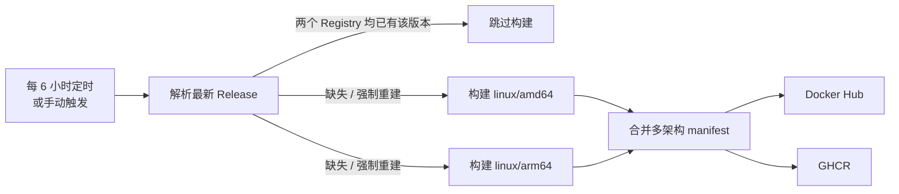

<!-- markdownlint-disable MD041 -->

<div align="center">

# Hermes Agent Docker

**自动跟踪上游最新版本，构建 `amd64` / `arm64` 镜像并同步发布到 Docker Hub 与 GHCR**

[](https://github.com/MinimaxFlora/hermes-agent-docker/actions/workflows/release.yml)
[](https://github.com/MinimaxFlora/hermes-agent-docker/actions/workflows/lint.yml)
[](https://hub.docker.com/r/dockorae/hermes-agent)
[](LICENSE)

</div>

> **非官方镜像**
>
> 本仓库不是 [NousResearch/hermes-agent](https://github.com/NousResearch/hermes-agent) 的官方发布渠道。镜像由上游源码按 MIT 许可证重新构建，上游项目及镜像内容的所有权利归其作者所有。生产环境请优先评估官方发布方式。

---

## 目录

- [镜像地址](#镜像地址)
- [标签规则](#标签规则)
- [快速开始](#快速开始)
- [数据、配置与安全](#数据配置与安全)
- [自动化流程](#自动化流程)
- [仓库结构](#仓库结构)
- [开发与校验](#开发与校验)
- [Fork 与自定义](#fork-与自定义)
- [常见问题](#常见问题)
- [许可证与致谢](#许可证与致谢)

## 镜像地址

| Registry   | 镜像                                | 拉取命令                                               |
| ---------- | ----------------------------------- | ------------------------------------------------------ |
| Docker Hub | `dockorae/hermes-agent`             | `docker pull dockorae/hermes-agent:latest`             |
| GHCR       | `ghcr.io/minimaxflora/hermes-agent` | `docker pull ghcr.io/minimaxflora/hermes-agent:latest` |

- 支持 `linux/amd64` 与 `linux/arm64`（Apple Silicon、ARM 服务器）。
- 两个 Registry 的内容与 digest 完全一致，可任选其一。
- 镜像包含 Python 运行时、Node 运行时、Chromium 等组件，体积较大，首次拉取需要耐心等待。

## 标签规则

| 标签                           | 含义                               | 可变性       |
| ------------------------------ | ---------------------------------- | ------------ |
| `latest`                       | 最新正式 Release                   | 随新版本移动 |
| `0.22.2`                       | 上游 Release 版本（去掉 `v` 前缀） | 不可变       |
| `v0.22.2`                      | 同上，保留 `v` 前缀的别名          | 不可变       |
| `sha-1a2b3c4`                  | 上游 commit 前 7 位                | 不可变       |
| `0.22.2-amd64`、`0.22.2-arm64` | 单架构源镜像                       | 不可变       |

说明：

- `latest` **只会**由“最新正式 Release”的自动构建或对应版本的手动构建更新，手动构建旧版本不会回退 `latest`。
- 自动任务只跟踪 GitHub Release，不跟随上游 `main` 分支的每次提交，避免不可复现的构建。
- 生产环境建议固定到不可变标签或 digest：

  ```bash
  docker pull dockorae/hermes-agent:0.22.2
  docker pull dockorae/hermes-agent@sha256:<digest>
  ```

## 快速开始

### 交互式 CLI

```bash
docker run -it --rm \
  -v hermes-data:/opt/data \
  dockorae/hermes-agent:latest
```

不带参数启动时，容器会进入 Hermes Agent 的交互式终端。

Linux 主机建议传入当前用户的 UID/GID，让容器写入的文件归属于你（**不要**使用 `docker run --user`）：

```bash
docker run -it --rm \
  -v hermes-data:/opt/data \
  -e HERMES_UID="$(id -u)" \
  -e HERMES_GID="$(id -g)" \
  dockorae/hermes-agent:latest
```

### Gateway 与 Dashboard（Docker Compose）

```bash
cd examples
HERMES_UID="$(id -u)" HERMES_GID="$(id -g)" docker compose up -d
```

启动后：

- `gateway` 常驻运行，接收各消息平台的事件。
- `dashboard` 默认只监听 `127.0.0.1:9119`，浏览器打开 <http://127.0.0.1:9119>。
- 查看日志：`docker compose logs -f gateway`。
- 停止：`docker compose down`。数据保留在宿主机 `~/.hermes`。

> Compose 示例使用 `network_mode: host`（与上游一致），仅适用于 Linux。macOS / Windows 的 Docker Desktop 不支持 host 网络，可先使用交互式 CLI，或参考上游文档自行调整网络与 Dashboard 监听方式。**不要把未加认证的 Dashboard 暴露到公网。**

### 升级

```bash
docker pull dockorae/hermes-agent:latest
cd examples && docker compose up -d
```

数据卷（`/opt/data`）不会因升级丢失。

## 数据、配置与安全

| 项目      | 说明                                                               |
| --------- | ------------------------------------------------------------------ |
| 数据目录  | 容器内 `/opt/data`（`HERMES_HOME`），必须持久化                    |
| 默认用户  | `hermes`（UID 10000），启动时按 `HERMES_UID` / `HERMES_GID` 重映射 |
| 配置文件  | 首次启动在 `/opt/data/.env` 生成模板，可挂载宿主机文件覆盖         |
| Dashboard | 默认 `127.0.0.1:9119`，存放 API Key，禁止裸奔在公网                |
| 更新方式  | 镜像不可变，更新 = 拉取新镜像并重建容器                            |

- API Key 等敏感信息请通过环境变量或挂载的 `.env` 注入，**不要**写进镜像或提交到仓库。
- 可用的环境变量非常多（模型供应商、消息平台、沙箱后端等），请以上游 [`.env.example`](https://github.com/NousResearch/hermes-agent/blob/main/.env.example) 与[官方文档](https://github.com/NousResearch/hermes-agent#readme)为准。
- NAS 用户（Synology / unRAID 等）可使用 `PUID` / `PGID` 别名。
- 容器内不要覆盖 entrypoint，`/init` 负责 s6 监督树、UID 重映射与数据卷权限。

## 自动化流程



`release.yml` 的执行步骤：

1. **Resolve**：通过 GitHub API 取 `releases/latest`，用 `git ls-remote` 解析 tag 对应的 commit；分别探测 Docker Hub 与 GHCR 是否已存在该版本标签。两者都存在时直接跳过，节省构建资源。
2. **Build**：在 `ubuntu-24.04`（amd64）与 `ubuntu-24.04-arm`（arm64）原生 Runner 上并行构建上游 `Dockerfile`，使用 BuildKit + GHA 缓存；构建前会生成 `install-stamp.json`，让 `hermes --version` 能报告真实的 commit。
3. **Publish**：用 `docker buildx imagetools create` 把两个单架构镜像合并为多架构 manifest，写入 `latest`、版本号、`v` 前缀别名与 `sha-<commit>` 标签，并校验平台与 digest。

触发方式：

| 方式                    | 行为                                                     |
| ----------------------- | -------------------------------------------------------- |
| `schedule`（每 6 小时） | 自动跟踪最新 Release                                     |
| `workflow_dispatch`     | 可指定 tag、强制重建、只构建单架构、或关闭推送做冒烟测试 |

定时任务是 UTC 时间，GitHub 在高峰期可能延迟数分钟到数十分钟。公共仓库的定时任务在连续 60 天无活动后会被自动禁用，提交一次或手动运行即可恢复。

### 手动触发示例

```bash
# 构建并发布最新 Release（即使已存在也重建）
gh workflow run release.yml -f force=true

# 只验证构建，不推送
gh workflow run release.yml -f push=false -f archs=amd64

# 构建指定版本（版本已存在时同样需要 force）
gh workflow run release.yml -f ref=v0.22.2 -f force=true
```

查看镜像的平台与 digest：

```bash
docker buildx imagetools inspect dockorae/hermes-agent:latest
docker buildx imagetools inspect ghcr.io/minimaxflora/hermes-agent:latest
```

## 仓库结构

```text
.
├── .github/
│   ├── actionlint.yaml          # actionlint 自定义 Runner 标签
│   ├── dependabot.yml           # Actions / npm 依赖更新
│   ├── ISSUE_TEMPLATE/          # Issue 表单
│   ├── pull_request_template.md
│   └── workflows/
│       ├── release.yml          # 同步上游 → 构建 → 发布
│       └── lint.yml             # Prettier / Markdown / actionlint / shellcheck / Python 测试
├── examples/
│   └── docker-compose.yml       # Gateway + Dashboard 示例
├── scripts/
│   ├── ci/install-actionlint.sh # 固定版本 + 校验和安装 actionlint
│   ├── install_stamp.py         # 生成镜像内 install-stamp.json
│   ├── publish-manifests.sh     # 合并多架构 manifest 并校验
│   └── resolve-upstream.sh      # 解析上游版本并判断是否需要构建
├── tests/
│   └── test_install_stamp.py    # 标准库 unittest
├── package.json                 # Prettier / markdownlint 工具链
└── README.md
```

## 开发与校验

本地需要 Node.js ≥ 20、Python ≥ 3.10、ShellCheck，以及 Docker（仅推送时需要）。

```bash
# JavaScript 工具链（Prettier + markdownlint）
npm ci
npm run lint
npm run format

# GitHub Actions 工作流
bash scripts/ci/install-actionlint.sh
.tools/actionlint -color

# Shell 脚本
shellcheck scripts/*.sh scripts/ci/*.sh

# Python 单元测试
python3 -m unittest discover -s tests -v
```

代码规范：

- 所有 GitHub Actions 固定到 commit SHA，并保留版本注释；Dependabot 负责升级。
- 工作流遵循最小权限原则，不使用 `pull_request_target`，不在日志中输出密钥。
- Shell 脚本统一 `set -Eeuo pipefail`，通过 ShellCheck。
- YAML / Markdown / JSON 由 Prettier 统一格式，Markdown 通过 markdownlint。
- Python 仅使用标准库，可直接在 Runner 上运行，无需额外依赖。

## Fork 与自定义

1. Fork 本仓库。
2. 在 **Settings → Secrets and variables → Actions** 中配置：
   - **Variables** → `DOCKERHUB_USERNAME`：Docker Hub 用户名（非机密）。
   - **Secrets** → `DOCKERHUB_TOKEN`：Docker Hub Access Token（Read & Write 权限）。

   > 用户名必须放在 Variables 而不是 Secrets：GitHub 会脱敏包含 Secret 值的输出，放在 Secret 中会导致镜像名输出被丢弃，构建标签变成空值。

3. GHCR 使用内置的 `GITHUB_TOKEN`，无需额外配置；首次推送后请在包设置中确认可见性。
4. 如需修改镜像名，调整 `release.yml` 顶部的 `IMAGE_NAME`；GHCR 命名空间自动使用仓库所有者（小写）。
5. 私有仓库无法使用 `ubuntu-24.04-arm` 公共 Runner，可设置仓库变量 `RUNNER_ARM64` 指向自建 Runner，或只构建 `amd64`。

> **安全提示**：本仓库的 Docker Hub Token 仅保存在 GitHub Actions Secret 中，从未写入代码或日志。若 Token 意外泄露，请立即在 Docker Hub 撤销并重新生成。

## 常见问题

**构建耗时多久？**

冷构建约 1–2 小时（取决于 Runner 与上游依赖），命中 GHA 缓存后会明显缩短。作业超时上限为 300 分钟。

**为什么某次定时任务没有构建？**

说明最新 Release 的版本标签已同时存在于 Docker Hub 与 GHCR。需要重建时手动触发并勾选 `force`。

**镜像启动后提示权限问题？**

请通过 `HERMES_UID` / `HERMES_GID`（或 `PUID` / `PGID`）传入宿主机 UID/GID，不要使用 `--user`。

**GHCR 拉取提示 denied？**

包默认可能是私有可见性。可在 GitHub 包页面将其改为 Public，或先 `docker login ghcr.io`。

**上游改了 Dockerfile 导致构建失败？**

提交 Issue 并附上失败的 workflow 链接。维护者会跟进上游变更；也可用 `workflow_dispatch` 指定旧 tag 临时规避。

## 许可证与致谢

- 本仓库的构建脚本、工作流与文档以 [MIT](LICENSE) 许可证发布。
- [Hermes Agent](https://github.com/NousResearch/hermes-agent) 同样使用 MIT 许可证，版权归 Nous Research 及其贡献者所有。
- 镜像内包含的第三方组件遵循各自许可证。
